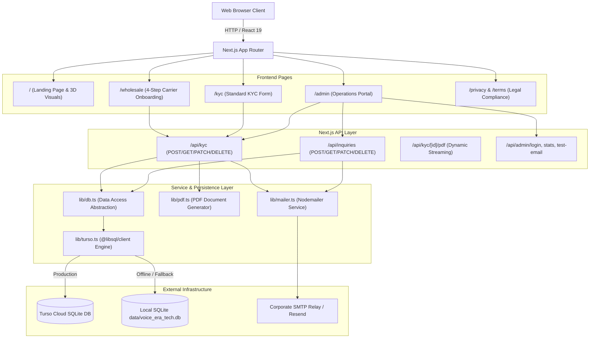

# System Architecture

## Architectural Overview
Voice Era Tech is an enterprise telecom and wholesale VoIP onboarding web application designed with Next.js App Router (React 19). It combines a high-performance marketing landing site, a 4-step carrier compliance onboarding wizard, and an administrative operations backoffice for reviewing carrier applications and routing inquiries.

## Data Flow & Request Lifecycle

### 1. Carrier Onboarding Flow (`/wholesale` or `/kyc`)
1. **User Input:** Carrier completes multi-step verification form (incorporation data, personal ID, FCC/ITG IDs, traffic profile, SIP interconnect IPs, and attestations).
2. **Client Validation:** Form fields validated in browser.
3. **API Dispatch:** `POST /api/kyc` receives JSON payload.
4. **Database Record:** `createKyc()` in `lib/db.ts` inserts record into `kyc_submissions` table via `lib/turso.ts`.
5. **Certified PDF Generation:** `generateKycPdf()` creates standard PDF document (Form VET-WHL-01 or VET-KYC-01) with legal and technical metadata.
6. **Notification Delivery:** `sendKycEmail()` dispatches PDF attachment to compliance mailbox and sends confirmation receipt to carrier signatory.
7. **Response:** Reference ID (`VET-WHL-XXXX` or `VET-KYC-XXXX`) returned to user with direct PDF download link.

### 2. Operations & Review Flow (`/admin`)
1. **Authentication:** Administrator submits credentials to `POST /api/admin/login`.
2. **Dashboard Ingestion:** Dashboard loads aggregated stats from `/api/admin/stats` and lists from `/api/inquiries` and `/api/kyc`.
3. **Status Workflow:** Administrators can update application status (`pending`, `under_review`, `approved`, `rejected`, `info_requested`) with notes via `PATCH /api/kyc/[id]`.
4. **PDF Inspection:** Admin can preview and download generated onboarding PDFs via `/api/kyc/[id]/pdf`.

## Layer Responsibilities
- **Presentation (`app/`, `components/`):** React 19 client and server components, Tailwind CSS v4 styling, Radix UI primitives.
- **API Routing (`app/api/`):** Next.js route handlers translating HTTP requests into domain operations.
- **Domain & Database Services (`lib/`):** Data storage abstractions, schema initialization, PDF building, and mail dispatch.
